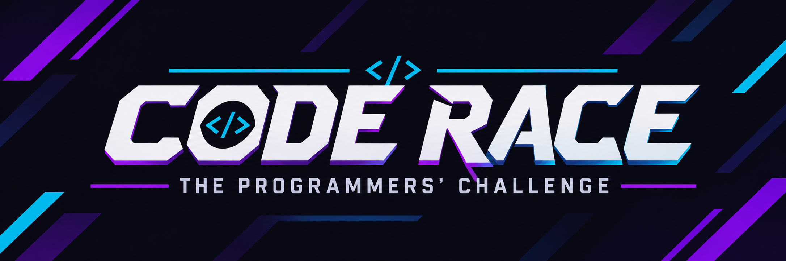
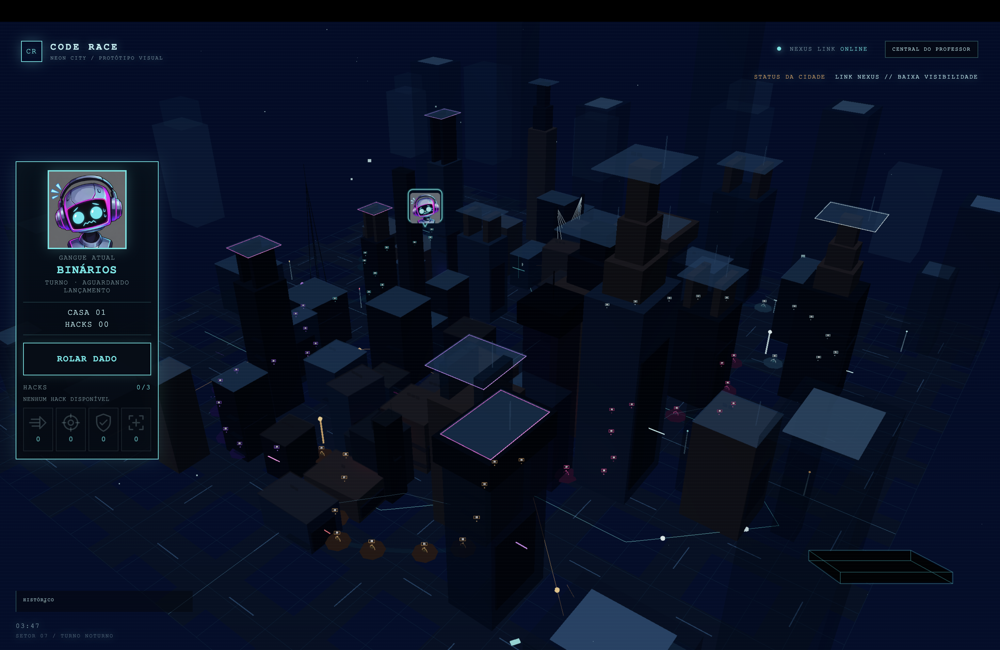

# CODE RACE — The Programmers' Challenge

A team-based educational programming game set in **NEON CITY**, a cyberpunk-inspired 3D world where players learn Python through challenges, strategy, and collaboration.



## About the Project

CODE RACE is a digital board game designed to make introductory programming education more engaging and interactive.

Created for collaborative learning activities, the game brings teams of players into NEON CITY, a fictional cyberpunk environment where they compete to overcome programming challenges and reach the Central Nexus.

The project combines a 3D game environment, turn-based board mechanics, Python questions, strategic abilities, and dynamic events in a desktop application.

## Gameplay

Players form teams and compete to progress across a board of 60 spaces. During their turns, teams roll a die, move across the city, and face programming challenges and special game events.

The objective is to reach **Central Nexus** and successfully complete the final challenge.

The game is designed for educational activities with students approximately 11–17 years old.

## Key Features

- **3D Environment:** An immersive cyberpunk-inspired city rendered with Three.js.
- **Team-Based Gameplay:** Matches support multiple teams competing in the same session.
- **Python Challenges:** Programming questions organized by difficulty.
- **Turn-Based Mechanics:** Dice rolls, board movement, and challenge resolution.
- **Strategic Abilities:** Special abilities that allow teams to influence the match.
- **Dynamic Events:** In-game events that can change the course of a match.
- **Teacher Control Interface:** Tools for managing teams, game events, corrections, and match flow.
- **Local Save System:** Match progress can be saved and restored on the device.

## Technology Stack

| Technology | Role in the Project |
|---|---|
| HTML5 | Application structure |
| CSS3 | Interface styling, visual effects, and animations |
| JavaScript | Gameplay logic, state management, and interactions |
| Three.js | 3D environment and scene rendering |
| Electron | Desktop application runtime |
| Node.js | JavaScript runtime and development environment |
| npm | Dependency management and project scripts |

## Architecture and Technical Overview

CODE RACE uses a local-first desktop architecture.

- **Electron** provides the desktop application shell.
- **HTML, CSS, and JavaScript** implement the interface and game logic.
- **Three.js** handles the 3D city environment.
- **JSON files** store the programming question banks and other structured data.
- **localStorage** is used for local game-state persistence.

The application does not require a remote backend, external database, or remote API for its gameplay.

Game assets and application resources are bundled locally.

## Getting Started

### Prerequisites

- Node.js
- npm

### 1. Clone the repository

```bash
git clone https://github.com/fernandodiogenes/CODE-RACE.git
```

### 2. Navigate to the project directory

```bash
cd CODE-RACE
```

### 3. Install dependencies

```bash
npm ci
```

### 4. Run the desktop application

```bash
npm run dev
```

## Testing

The project includes an automated desktop smoke test that checks important application and gameplay flows.

Run the test with:

```bash
npm run test:desktop
```

The smoke test checks application startup, local resource loading, question bank availability, the introduction, team registration, 3D gameplay initialization, and local save functionality.

## Building the Application

The project uses **Electron Builder** to generate desktop distributions.

### macOS — Apple Silicon

```bash
npm run build:mac
```

### Windows — Installer

```bash
npm run build:win:installer
```

### Windows — Portable Version

```bash
npm run build:win:portable
```

Build artifacts are generated in:

```text
dist/neon-city/
```

**Platform note:** The macOS build is configured for ARM64. Windows distributions should be generated in a Windows environment.

For detailed platform-specific instructions, see:
- [Windows Build Guide](prototype/neon-city/BUILD-WINDOWS.md)
- [macOS Build Guide](prototype/neon-city/BUILD-MACOS.md)

## Project Structure

```text
CODE-RACE/
│
├── prototype/
│   └── neon-city/
│       ├── assets/             # Models, images, and game resources
│       ├── src/                # Game modules and application logic
│       ├── index.html          # Main application page
│       ├── neon-city.css       # Interface styles
│       ├── neon-city.js        # Main game entry point
│       └── BUILD-WINDOWS.md    # Windows build instructions
│       └── BUILD-MACOS.md      # macOS build instructions
│
├── electron-main.cjs           # Electron entry point
├── package.json                # Dependencies and scripts
├── package-lock.json           # Locked dependency versions
├── GAME_RULEBOOK.md            # Official game rulebook
├── README.md
└── .gitignore
```

## Project Documentation

- [Game Rulebook](GAME_RULEBOOK.md) — Official rules, house effects, and gameplay instructions.
- [Windows Build Guide](prototype/neon-city/BUILD-WINDOWS.md) — Instructions for generating Windows distributions.
- [macOS Build Guide](prototype/neon-city/BUILD-MACOS.md) — Instructions for generating macOS distributions.

## Educational Purpose

CODE RACE was designed to support introductory programming education through collaborative problem-solving and game-based learning.

By combining Python challenges with strategic gameplay, the project encourages logical reasoning, teamwork, and the practical application of programming concepts.

---